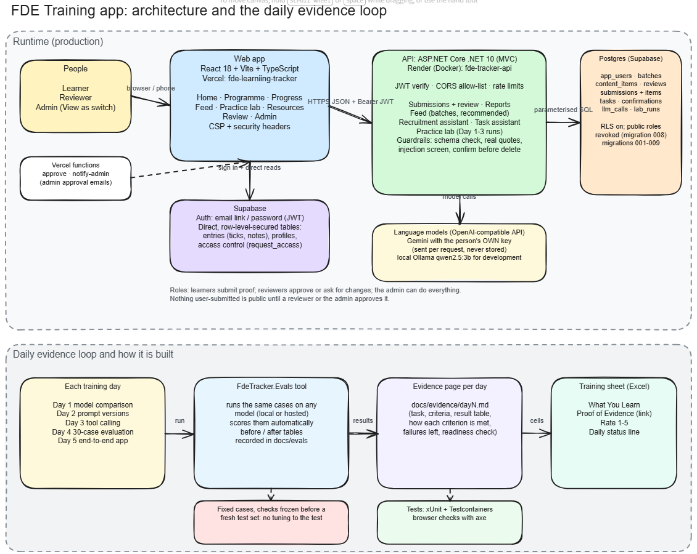

# Architecture: FDE Training app

The editable diagram is [architecture.excalidraw](architecture.excalidraw): open https://excalidraw.com, then Menu > Open, and pick this file.

## Parts

| Part | Where | What it does |
|---|---|---|
| Web app | `FDE-Learniing-Tracker` repo, Vercel (fde-learniing-tracker) | React 18 + Vite + TypeScript. Home, Programme, Progress, Feed, Practice lab, Resources, Review and Admin pages. Sends security headers (CSP). |
| Supabase Auth | Supabase | Email link or password sign-in. Issues the signed token (JWT) the API checks. |
| Supabase tables used directly by the web app | Supabase | `entries` (ticks and notes), `profiles` and the access check (`request_access`). Row-level security keeps each person to their own rows. |
| API | this repo (`FdeTracker.Api`), Render (fde-tracker-api) | ASP.NET Core .NET 10, Controllers -> Services -> Repositories. Submissions and review, reports, the feed, both assistants and the Practice lab. |
| Database | Supabase Postgres | `app_users`, `batches`, `content_items`, `reviews`, submissions, `tasks`, `llm_calls`, `lab_runs` and more. Migrations 001-009 run at start-up. Migration 008 turns row-level security on for every backend table and removes the public roles' rights. |
| Language models | Gemini (the person's own key) or a local Ollama model | OpenAI-compatible chat API. The own key travels in a request header for that one call and is never stored or logged. |
| Evals tool | this repo (`FdeTracker.Evals`) | Runs the same fixed cases on any model, scores them automatically and writes before/after tables to `docs/evals`. |
| Vercel functions | web repo `api/` | `approve` and `notify-admin`: the admin approval emails. |

## Roles

- **Learner:** ticks days, submits proof with a short note and a 1-5 self-rating, sees their own report.
- **Reviewer:** approves or asks for changes, sees everyone's reports.
- **Admin:** everything a reviewer can do, plus people, roles and batches. The "View as" switch shows what a learner sees.

Nothing a person submits is public until a reviewer or the admin approves it.

## Guardrails on the assistants

- A model answer must match a fixed JSON shape before anyone sees it.
- Every claim needs a real quote from the profile; a rating needs evidence.
- An instruction screen checks profiles for hidden orders.
- Delete actions in the task assistant only create a confirmation question, which is checked again on "yes".
- Own-key calls do not use the shared daily limit.

## Daily evidence loop

Each training day: build the task, run `FdeTracker.Evals` where it applies, write `docs/evidence/dayN.md` (task, criteria, result table, how each criterion is met, failures left), then paste three cells into the training sheet (what was learned, proof link, rating). The test set for a day is fixed before it is run, and a second, fresh set is checked afterwards so the checks are not tuned to the test.

## Limits

- The first request after the free Render service sleeps can take about a minute.
- The local model (3B) is small; results on larger or hosted models may differ.
- Web and API are two repositories and are deployed separately.
